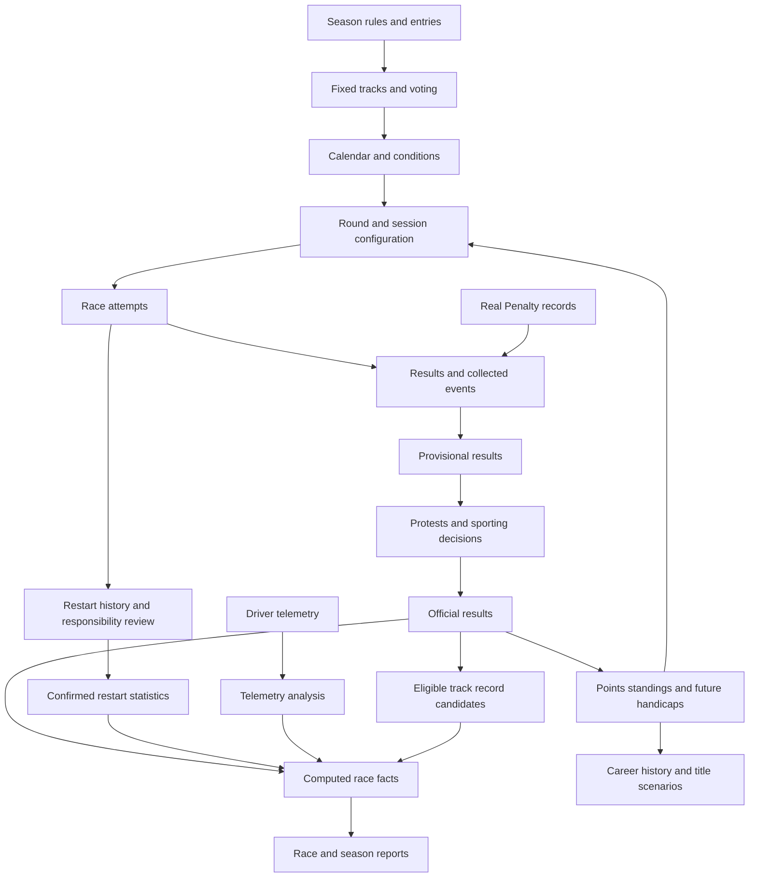

# Piston Cup Paddock development plan

Date: October 11, 2026

Status: Product and development plan. Application implementation has not started.

Piston Cup Paddock manages a private Assetto Corsa championship for a group of friends. It connects season voting, calendars, race results, restarts, sporting rules, track records, telemetry, and race commentary. Drivers receive a clear view of their next event and progress. Admins receive tools to organize races and resolve corrections without losing history.

The current race environment uses Content Manager's server tool, Real Penalty, Custom Shaders Patch (CSP), and Sol. The application should work alongside this environment. Data collection must support the existing race setup before the project considers a replacement server workflow.

This plan combines the original feature outline, the discussion about reliable championship management, and the additions for restarts, track records, and fixed tracks. Explicit user requirements define the product scope. Proposed defaults below make development concrete but remain configurable or subject to a documented decision.

## Contents

- [1 Product goals and scope](#1-product-goals-and-scope)
- [2 Requirements and proposed defaults](#2-requirements-and-proposed-defaults)
- [3 Domain model and relationships](#3-domain-model-and-relationships)
- [4 Accounts identity roles and languages](#4-accounts-identity-roles-and-languages)
- [5 Season planning voting and fixed tracks](#5-season-planning-voting-and-fixed-tracks)
- [6 Calendar conditions and race preparation](#6-calendar-conditions-and-race-preparation)
- [7 Race lifecycle and official results](#7-race-lifecycle-and-official-results)
- [8 Restart tracking and responsibility](#8-restart-tracking-and-responsibility)
- [9 Sporting rules points and handicaps](#9-sporting-rules-points-and-handicaps)
- [10 Career level safety and driver history](#10-career-level-safety-and-driver-history)
- [11 Track records and record conditions](#11-track-records-and-record-conditions)
- [12 Data sources collection and reliability](#12-data-sources-collection-and-reliability)
- [13 Race statistics maps and telemetry](#13-race-statistics-maps-and-telemetry)
- [14 Championship scenarios](#14-championship-scenarios)
- [15 AI reports and race engineer](#15-ai-reports-and-race-engineer)
- [16 Screens navigation and design](#16-screens-navigation-and-design)
- [17 Audit history imports and corrections](#17-audit-history-imports-and-corrections)
- [18 Architecture and deployment](#18-architecture-and-deployment)
- [19 Development stages](#19-development-stages)
- [20 Test strategy and acceptance scenarios](#20-test-strategy-and-acceptance-scenarios)
- [21 Decisions to resolve before dependent work](#21-decisions-to-resolve-before-dependent-work)
- [22 Development workflow and first tasks](#22-development-workflow-and-first-tasks)
- [23 Technical references](#23-technical-references)

## 1 Product goals and scope

### Product goals

- Organize multiple championships and seasons, including seasons already in progress and historical seasons.
- Reduce manual work through reliable imports, automatic collection, and repeatable calculations.
- Make rules, results, penalties, restarts, records, and administrative changes understandable to every driver.
- Present racing data through readable tables, charts, maps, comparisons, and reports.
- Build a shared championship history with Spanish as the default language and English as an option.

A complete season must work even when detailed telemetry or AI services are unavailable. The first usable version must support manual input and file imports. Advanced analysis can add value without becoming a condition for recording results.

### Scope boundaries

The first restart feature records what happened. It does not decide whether to restart, issue a restart command, or automatically assign blame.

AI explains calculated facts and offers supported advice. Sporting calculations and administrative decisions remain in the rules and review workflows.

The initial application serves a friends' league. Public matchmaking, paid subscriptions, automatic incident adjudication, and control of the race server are outside the initial scope.

## 2 Requirements and proposed defaults

### Explicit product requirements

The application must support accounts with passwords, admin and driver permissions, additional configurable roles, and normal driver participation by admins. It must support multiple championships, season configuration, and historical data.

Season voting must cover car classes and tracks. Admins control eligibility, vote limits, weights, ballot visibility, runoffs, and manual selections. Seasons can also skip voting.

The driver experience must include championship position, points, past results, next-race details, ballast, restrictor, reports, telemetry comparisons, and a later race engineer.

Race analysis must include lap statistics, sectors where available, incidents, maps, comparisons, automatic sporting calculations, and championship title scenarios. Reports must combine supported facts with commentary and humor.

Restarts must retain reasons and responsibility. Race and championship reports must identify who caused the most confirmed restarts. General track records must retain the conditions of each record. Fixed tracks must bypass voting and remain part of the calendar.

Deployment must support Docker. Testing must cover units, integrations, and complete user flows. LiteLLM is the proposed abstraction for AI providers. Vite is the proposed frontend build tool.

### Proposed initial defaults

| Topic | Proposed default |
| --- | --- |
| Result publication | Automatic provisional results followed by admin approval |
| Protest window | Configurable per season, with an explicit closing time |
| Votes | Equal voting power unless the season defines visible exceptions |
| Career level | Accumulated official points across seasons |
| Restart management | Manual tracking with optional imported evidence |
| Restart responsibility | Admin confirmation, with shared and unknown outcomes |
| Aborted race attempts | Preserved in history and excluded from championship points |
| Initial record eligibility | Valid laps from accepted qualifying and final race attempts |
| Driver collector | Optional for basic results, needed for supported advanced telemetry |
| Administrative corrections | New versions and recalculation, with original evidence preserved |
| Architecture | One application with separate modules and background processing |

Exact points tables, incident weights, protest duration, handicap progression, and record categories remain season or league decisions. Development must not invent these values silently.

## 3 Domain model and relationships

### Competition hierarchy

The main hierarchy is League -> Championship -> Season -> Round -> Session -> Attempt.

| Entity | Purpose and important links |
| --- | --- |
| League | The group, shared drivers, content catalog, and league-wide records |
| Championship | A recurring competition with one or more seasons |
| Season | Entries, rules, voting, calendar, standings, and reports |
| Round | A scheduled event at an exact track layout |
| Session | Practice, qualifying, sprint, or main race |
| Attempt | One actual start of a session, with its own times and source data |
| Driver profile | Stable identity, career history, and linked game identifiers |
| User account | Login, language, permissions, and an optional driver profile |
| Season entry | A driver's car, number, team, and eligibility for one season |
| Content version | A specific car or track layout and its known revision |
| Rules version | The sporting configuration that governs specified rounds |
| Ballot | Candidates, eligible voters, vote rules, deadlines, and results |
| Incident | A grouped racing event with evidence and involved drivers |
| Penalty decision | A reviewed sporting consequence linked to evidence |
| Restart | A restart decision linked to an abandoned attempt and its replacement |
| Result version | An imported or reviewed classification and its publication status |
| Record candidate | A lap considered for a record under a defined category |
| Track record | An accepted record with its lap, category, and conditions |
| Report version | A narrative tied to specific results and facts |
| Audit entry | Who changed what, when, why, and with which consequences |

Attempts are necessary because a round can contain several abandoned starts and one accepted race. A new attempt must never create a second championship round automatically.

Driver profiles can exist without accounts. This supports historical imports and drivers who later register. Account ownership of a historical profile requires an explicit matching process.

### Connected workflows

Votes establish the calendar. Sessions and attempts produce evidence. Official decisions establish championship outcomes. Reports use those outcomes and clearly labeled supporting data.

## 4 Accounts identity roles and languages

### Accounts and game identity

Accounts use passwords and support account recovery. Store password hashes through a standard password implementation. Never store readable passwords or place credentials in the audit log.

Match game results through a stable identifier such as a Steam GUID. Display names can change and must not define ownership of results. Session car identifiers also require matching because they can change between connections and attempts.

Admins can link unmatched results to profiles after an import preview. Profile merges must preserve sources and audit history.

### Roles and permissions

| Role | Initial permissions |
| --- | --- |
| Driver | View permitted results, vote when eligible, manage profile, submit protests, and control telemetry sharing |
| Admin | Manage seasons, votes, calendar, imports, rules, decisions, users, and publication |
| Steward | Later role for incident and restart responsibility review |
| Custom role | Admin-selected permissions within the relevant league or championship |

An admin account acts as a normal driver during ordinary use. An administrative workspace exposes management actions. Administrative status does not automatically grant extra votes.

Define permissions by capability, such as publishing results or editing a ballot. Scope them to the relevant competition. Custom roles must not accidentally grant access to unrelated championships.

### Languages and time

Spanish is the default interface language. English is an account preference. Translate navigation, tooltips, labels, validation messages, and human-readable audit descriptions.

Reports retain their language and version. Support Spanish reports first, with English generation or translation as a later option. User names and original evidence remain unchanged.

Store scheduled instants independently from their display timezone. Show the race date and time in the driver's timezone, with the event timezone available. Keep wall-clock race scheduling separate from simulated track time.

## 5 Season planning voting and fixed tracks

### Season preparation

Admins create a season with its intended race count, voting rules, sporting rules, entrants, fixed tracks, and condition policy. They can clone useful configuration from a previous season.

Two setup paths must exist: a new season through voting, and a manual season that skips voting. The manual path supports an already-started championship and historical imports.

### Fixed tracks

Admins can reserve one, two, or any configured number of fixed rounds before track voting. Each reservation identifies an exact track layout. A fixed round can also reserve a calendar position and date.

The configured total includes fixed and voted rounds. For an eight-round season with two fixed tracks, voting fills six remaining slots. Validate that the fixed round count does not exceed the total.

Exclude fixed track layouts from the candidate pool by default. Intentional repeat visits require an explicit season option. Different layouts of the same venue are distinct candidates, but a venue-level exclusion can be configured.

Track eligibility must account for content access, versions, grid capacity, and supported conditions. Fixed tracks require the same technical checks as voted tracks.

Every calendar entry shows its origin: fixed, voted, or manually added. A later replacement must retain the original selection and the admin's reason.

### Car and track ballots

Admins manually populate car-class candidates. Voting selects the configured number of classes. Track voting uses the same ballot system and fills the available calendar slots.

| Voting setting | Required behavior |
| --- | --- |
| Method | Single choice, multiple selection, or a later vote-budget method |
| Selection limit | Maximum distinct options each voter can select |
| Vote power | Equal by default, with individual, role, or condition-based exceptions |
| Eligibility | Named people, roles, and prior-season participation thresholds |
| Voter list | Snapshot eligible voters when the ballot opens |
| Identity visibility | Show or hide individual choices from other drivers |
| Total visibility | Show running totals, hide them until closing, or hide them from drivers |
| Admin visibility | Admins can inspect ballots regardless of driver visibility |
| Deadlines | Opening, closing, permitted vote changes, and optional reminders |
| Participation | Minimum participation and a recorded fallback |
| Selected options | One or more classes, or the required number of tracks |

Selecting up to three options is different from distributing three weighted votes. The interface must explain the chosen method and any extra power before a voter submits.

Prior-season eligibility must define the relevant season, counted starts, and threshold. Later changes to roles or results do not silently change an open ballot's voter list.

Because admins can inspect ballots, describe restricted visibility as hidden from other drivers. Do not promise anonymity from admins.

### Ties and overrides

Optional runoffs include only candidates tied for unresolved selection places. If three tracks tie for the last two slots, the runoff selects two of those tracks.

Runoff rules inherit the main ballot rules unless admins configure an override. For example, a multiple-selection ballot can use one selection per voter during a runoff.

Support repeated runoffs, including an unlimited setting. Recommend a configured limit and final fallback to prevent planning from remaining open indefinitely.

Admins can close voting early and select manually. Require a reason, preserve submitted votes, and identify the outcome as an override. Equal rules remain the default for all drivers.

Track selection establishes which venues to race. Calendar order and dates require a separate scheduling step or explicit ordering rule.

## 6 Calendar conditions and race preparation

Each round identifies its track, layout, content version, sessions, car eligibility, date, duration or lap count, and applicable rules version. It also identifies expected ballast and restrictor for each entrant.

Store announced conditions separately from observed conditions. Announced conditions include simulated time, weather, temperature, grip, and other available settings. Actual data can differ and must not overwrite the announcement.

Admins can enter conditions manually or draw them from an allowed pool. The season defines the announcement deadline and permitted combinations. Record the draw, its reproducibility information, and any reroll or manual override.

The application must not assume that every desired weather or night setting works with the group's current CSP and Sol versions. The content check must establish supported combinations.

A race briefing shows the exact layout, content requirements, announced conditions, schedule, sporting rules, individual handicaps, and any current restart guidance. Add track tips and supported setup advice when available.

Attendance confirmation, availability voting, and calendar export reduce coordination work. Initially, notifications can appear inside the application. External messaging integrations require a separate future scope decision.

## 7 Race lifecycle and official results

### Session and result states

| State | Meaning |
| --- | --- |
| Scheduled | The session belongs to a planned round |
| Collecting | An attempt is running or awaiting its data |
| Import failed | The source needs repair, rematching, or another upload |
| Provisional | The application calculated results, but review remains open |
| Under review | Protests or decisions can affect the result |
| Official | An authorized person approved the result version |
| Canceled | The session does not award normal results under the selected policy |

An attempt separately carries its status: active, completed, abandoned, accepted, or invalidated. The accepted attempt supplies the race classification. Later sprint support can create another session with its own accepted attempt.

### End of race workflow

1. Match incoming data to the season, round, session, attempt, and drivers.
2. Preserve the source and calculate a provisional classification with data-coverage warnings.
3. Review incidents, penalties, restarts, and record candidates within the applicable window.
4. Approve official results and calculate points, standings, ratings, and future handicaps.
5. Publish official facts and updated reports, with links to their result version.

Automatic publication creates provisional results first. The proposed initial policy requires admin approval for official results. A later policy can approve automatically after the review window if no unresolved issues remain.

### Protests and penalties

A protest identifies the session and attempt, lap or time, involved drivers, evidence, and requested review. Stewards record a decision, reason, sporting consequence, and any appeal status.

Automatic penalties, penalties already served during the race, and later steward penalties need distinct records. Import reconciliation must prevent the application from applying a penalty twice.

A result correction creates a new version. It recalculates affected standings and other derived information. Old reports become outdated, and updated reports retain their own history.

Completed rounds retain the actual conditions, ballast, and restrictor used. Recalculation can change future assignments, but it cannot rewrite physical race history.

## 8 Restart tracking and responsibility

### Current league practice

The group usually restarts after a first-lap crash. For longer tracks, with expected laps around 2.5 minutes or more, the group can set a point beyond which it will not restart.

Initially, the application only records restarts. It can store first-lap guidance and a track-specific cutoff description for reference. It must not enforce a cutoff or decide whether a restart was permitted.

### Attempt model

All starts remain attached to the same session. A restart closes one attempt and creates or links its replacement. Preserve the abandoned attempt's evidence, events, and available laps.

Example: Round 4 has Attempt 1, abandoned after a Turn 2 collision, and Attempt 2, accepted after the race finishes. The round records one restart and awards points once.

A manual import can reconstruct this history even if no collector was active. Unknown timestamps or missing replacement data must remain explicit.

### Restart information

| Field | Required meaning |
| --- | --- |
| Session and attempts | The abandoned attempt and its replacement, when known |
| Timing | Decision time, elapsed race time, and lap when known |
| Location | Corner, track position, map coordinates, or a manual description |
| Reason | First-lap crash, technical issue, server problem, wrong configuration, false start, or other |
| Explanation | Human description of why the group restarted |
| Incident links | One or more related incidents or supporting evidence |
| Requested by | The person who asked for the restart, when known |
| Executed by | The person who pressed restart or issued the command, when known |
| Logged by | The account that entered the record |
| Responsibility | Confirmed driver or drivers, racing incident, technical cause, or unknown |
| Review status | Pending, confirmed, corrected, or disputed |
| Decision history | Reviewer, time, reason, and earlier versions |

The person who requested or executed a restart is not necessarily responsible for its cause. An involved driver is not automatically the responsible driver.

Admins assign responsibility from evidence. Automatic event matching can suggest linked collisions later, but it must not confirm fault.

### Restart statistics and reports

Race reports include total restarts before the accepted race, reasons, attempt timelines, and confirmed responsibility counts. Season reports aggregate these across rounds and identify the driver or drivers with the most confirmed restarts caused.

Use these counting rules initially:

- Count each restart once in the event total, even when it has several linked collisions.
- Give each confirmed responsible driver one involvement in a shared-responsibility restart. Label these as confirmed restarts caused, including shared responsibility.
- Explain that individual counts can exceed the total because one restart can have several responsible drivers.
- Keep pending, disputed, technical, and unknown causes outside the confirmed driver ranking and show their totals separately.
- Show ties in the ranking and recalculate it after responsibility corrections.

A later report can add rates per start or fractional shared responsibility. Those measures must use clear denominators and separate labels.

AI commentary can mention a confirmed restart leader with the configured humor level. It must not turn pending allegations into statements of guilt.

Abandoned attempts do not award championship points. The proposed initial safety policy also excludes their exposure and incidents from the official rating. Show their incident statistics separately and revisit this policy before enabling safety ratings.

Abandoned attempts do not enter the main track-record category by default. Their valid laps can remain visible in attempt analysis. Other record policies require explicit categories.

### Later restart assistance

A future phase can represent a cutoff as a named corner, normalized track distance, elapsed time, or another precise marker. It must define whose progress controls the cutoff, such as the leader's position.

Expected lap duration can help suggest a policy, but it must not silently decide the cutoff. Server restart commands and automatic enforcement require a later, explicit feature decision.

## 9 Sporting rules points and handicaps

### Rules versions

Each season has a versioned rulebook. Each round saves the applicable version. An admin change identifies its effective round and whether it applies prospectively or corrects earlier results.

The editor should start with structured settings and presets. A general expression language is a later feature if actual rules exceed the supported settings.

### Points and classification

Support editable position points, qualifying or pole bonuses, fastest-lap bonuses, and eligibility conditions. Define DNS as did not start, DNF as did not finish, and DSQ as disqualified.

The rulebook must specify minimum completed distance, disconnect treatment, reconnects, guest drivers, late entrants, substitute drivers, and how unclassified drivers score. Bonus laps must satisfy the configured validity rules.

Season scoring can later include dropped results and team standings. If enabled, those rules must govern standings and title mathematics consistently.

Tiebreakers use an explicit ordered list, such as wins, second places, subsequent places, then an agreed fallback. Cancellation, reduced-point races, restarts, and replacement rounds also require configured policies.

### Ballast and restrictor

Support independent rules for ballast in kilograms and restrictor in percentage points. Rules identify a trigger, progression, maximum, reduction or reset behavior, and effective session.

A progression can depend on career wins, season wins, consecutive wins, or another supported counter. The admin must choose the counter and its reset scope.

For the original example, explicitly choose whether successive wins add 2, 3, and 4 percentage points or set totals to those values. Do not infer one meaning from a percent symbol.

Each assignment shows its explanation: previous value, triggering result, applied increase, cap, and resulting next-round value. Manual adjustments retain their reason and can follow a temporary or persistent policy.

Separate assigned values from observed values used on the server. A pre-race comparison can warn about differences when the integration supports reading them.

Rule previews run against sample or historical results without changing official outcomes. Validate units, supported ranges, and effective dates.

## 10 Career level safety and driver history

### Career progression

A driver's career level derives from accumulated official championship points across seasons. It does not reset at a season boundary. Titles, wins, podiums, participation, and milestones can appear alongside it.

An admin can manually reset or adjust the career level as requested. Record the effective adjustment and reason without deleting the underlying race history. Recalculation must respect the recorded adjustment policy.

Raw lifetime points favor longer participation and different scoring scales. Present them as accumulated achievement. Show season position, points per start, and head-to-head history separately where useful.

A competitive skill rating is optional future work. It must not share a label with career level or safety rating.

### Safety rating

Use an iRacing-inspired approach with transparent league rules. iRacing's documented principles include incident points, corner exposure, session weights, and incident involvement without automatic fault attribution. Its exact behavior must not be promised as a replicated formula.

Potential incident categories include track-limit violations, contact with cars, contact with the environment, spins or loss of control, and pit speeding. Detectability and sporting meaning differ by source.

Define incident weights, completed-corner or other exposure measurement, session weights, recent-history window, rating scale, and minimum data threshold before enabling the rating.

Group one connected crash sequence into one incident according to a documented time and event policy. Repeated packets and multiple sources must not multiply the same incident.

New drivers receive a provisional rating until enough valid exposure exists. Missing data produces an unknown or incomplete status, not a zero-incident race.

Safety records identify their rules version and data coverage. Show the incident count, measured exposure, and rating change explanation. Changes to the formula create a new version and an explicit recalculation policy.

Keep safety involvement separate from steward responsibility. Pit speeding can remain a sporting penalty without sharing the weight of a collision. Restarts caused remain a separate statistic unless the league explicitly adds a rating rule.

Historical seasons with only points or classifications contribute to career history. They do not create invented laps, telemetry, or safety exposure.

## 11 Track records and record conditions

### Record scope and categories

Support a general league record board across championships and seasons. Drivers can filter by track, exact layout, car, class, session type, and available conditions. A season record board can use the same data with a narrower scope.

An overall board can show the fastest accepted lap regardless of car. It must also show the car and context. Comparable boards use exact track layout and car, with versions where known.

The proposed initial categories are qualifying records and race records. Practice or unrestricted records can follow later. Class records require a defined class membership version because admins can change which cars belong to a class.

Do not assume one record combines every condition fairly. Retain the absolute record while allowing condition filters or explicit comparable categories. Filters with missing values must show what data they exclude.

### Record information

| Category | Information to retain when available |
| --- | --- |
| Performance | Lap time, lap number, sectors, and validity status |
| Driver | Profile and stable game identity |
| Content | Car, car version, track, layout, and track version |
| Session | Practice, qualifying, or race, plus round and attempt |
| Time | Real date and simulated track time |
| Weather | Weather description, temperatures, wetness or rain, and grip |
| Car state | Tires or compound, known fuel level, ballast, and restrictor |
| Rules | Assists, damage or relevant server settings, and record category |
| Evidence | Source lap, result version, collector coverage, and reviewer where applicable |
| Provenance | Automatically collected, file-imported, manually entered, or historically reconstructed |

Record actual observed conditions when available. Keep announced conditions as a separate reference. If only configuration is known, identify it as configured rather than measured.

Use unknown values explicitly. Do not invent weather, fuel, tires, or setup details from a lap time.

### Eligibility and updates

A record candidate must satisfy the category's lap validity, session, source, and review rules. The proposed initial policy accepts qualifying laps and laps from the final accepted race attempt after approval.

Exclude invalid laps and abandoned race attempts from the main board by default. Any later unrestricted attempt category must be visibly separate.

A time penalty does not automatically invalidate every lap from that race. A lap-specific infringement or disqualification affects record eligibility according to explicit record rules.

Retain previous record holders and improvements as history. Equal times can have shared holders rather than an invented precision-based winner.

If a correction invalidates the current record, select the next eligible candidate and retain the invalidated record's history. Reimports must not create duplicate improvements or notifications.

Manual historical records require an evidence or verification status. Drivers can filter to verified records while still viewing legacy information.

## 12 Data sources collection and reliability

### Capability map

| Data | Initial source plan | Important check |
| --- | --- | --- |
| Race classification and lap times | Server result files and manual imports | Confirm file fields and official penalty treatment |
| Driver identity | Game GUIDs and profile matching | Confirm stability across reconnects and attempts |
| Session and attempt transitions | Server events plus manual mapping | Distinguish restart, new session, and reconnect |
| Contacts and positions | Server plugin event collection | Establish coverage, precision, and duplicate behavior |
| Real Penalty decisions | Available logs, exports, or supported interface | Check the installed version and served penalties |
| Sector times | Confirmed result or event fields, then driver data where needed | Do not promise fields before inspecting samples |
| Detailed driving telemetry | A driver collector through supported AC interfaces | Confirm inputs, rates, timestamps, and overhead |
| Weather and car conditions | Configuration and supported observed data | Distinguish planned settings from observations |
| Setup information | Explicit driver upload or supported extraction | Require ownership and sharing permission |

The server plugin protocol supports event types useful for laps, positions, connections, and collisions. Its exact behavior with the group's installed configuration requires a small integration assessment.

### Server collector

The server owner runs a companion collector near the AC server. It reads supported files and events, preserves raw evidence, and uploads data to the application.

Real Penalty and the collector must coexist with the configured plugin connection. Inspect the actual routing and port configuration before choosing a relay or multiplexing approach. The plan does not assume multiple consumers work automatically.

Collectors identify the server, collection session, source events, and upload batches. Persist buffered data locally and retry safely. A cloud outage must not stop the game server or lose an entire session.

Collectors use their own credentials and limited permissions. The application must not trust an uploaded file to choose arbitrary users, seasons, or administrative actions.

### Driver collector

The proposed driver collector supplies detailed data the server cannot supply reliably. Basic championship participation must continue without this collector. This does not change the group's existing Real Penalty client requirements.

Initially, post-session batch uploads are enough unless a chosen feature needs live data. A later in-game app or companion program must show recording status and have a clear installation process.

Drivers choose whether teammates, other drivers, or admins can access detailed inputs and setups. Define retention and download behavior before rollout.

### Data quality and recovery

Retain source timestamps, receipt times, units, coordinate conventions, and version metadata. Align telemetry using session identity and a documented clock strategy. Do not rely only on the time an upload arrived.

Repeated uploads must produce the same stored event or result rather than duplicates. Detect late, missing, and out-of-order packets. Group incidents across sources while preserving their original evidence.

Show coverage at session and driver level. A disabled collector, partial position stream, and missing sectors must produce distinct messages.

An import preview shows matched drivers, selected attempts, missing fields, penalties, and proposed changes. Unmatched or ambiguous data stays pending for admin review.

Uploads, background calculations, and reports have visible processing states and retry controls. A failed AI task must not make the result import fail.

## 13 Race statistics maps and telemetry

### Classification and lap tables

Show official and provisional status prominently. Classification includes finishing position, total time or gap, completed laps, penalties, points, best lap and lap number, average lap, average clean lap, and grouped incident count.

Each driver has a lap table with lap time, sectors when available, validity, pit status, incidents, and relevant annotations. Green marks the driver's best valid values. Purple marks the session's best valid values. Text and icons must carry the same meaning.

For every average, show the included lap count and exclusion rules. Clean-lap settings define invalid laps, cuts, contacts, pit laps, out laps, and in laps. Missing incident coverage cannot support an unqualified clean-lap claim.

The theoretical lap sums the driver's best eligible sectors from a defined session and attempt. Label it theoretical. Different conditions, fuel, and tires can make the combined time unattainable.

### Incident maps

Support an incident heatmap and individual markers. Filters include driver, attempt, lap, incident type, measured intensity, and reviewed outcome.

Identify car-to-car contact, environment contact, and supported spin or loss-of-control detections. Measured impact intensity is separate from fault and sporting severity.

A marker opens the source event and linked review. Manual restart descriptions can appear without an exact map location.

Each exact track layout needs a map and a tested mapping from world positions to display coordinates. Missing map support must not block tables and results.

### Position replay

A simplified replay moves driver dots through a recorded position stream. Include playback speed, pause, attempt selection, timeline scrubbing, and incident or restart markers.

This is a position replay, not a full AC replay. Missing samples need visible gaps or labeled interpolation. Do not reconstruct complete movement from a final classification.

### Lap comparisons

Let drivers choose two eligible laps, with best valid laps as the default. Offer both dots on one map or side-by-side maps. Compare sector times and show delta along the track.

Align telemetry by distance around the same layout. Define the delta sign and reference lap clearly. Show car, ballast, restrictor, tires, conditions, and coverage beside the comparison.

Advanced views include speed, throttle, braking, steering, gears, racing line, and supported tire or fuel data. Every channel requires a confirmed source and clear units.

A setup suggestion must not treat different cars, handicaps, or weather as a driving deficit without explanation.

## 14 Championship scenarios

Calculate mathematical title status through the same rules that calculate standings. Include remaining rounds, maximum bonuses, eligibility, dropped results, cancellations, and championship tiebreakers.

Show whether the leader is already champion, can guarantee the title through a feasible points outcome, or still depends on rival results. Consider every rival who can still win or tie under the rules.

A guaranteed requirement is different from a possible scenario. For example, two wins and a fourth place may win under stated rival assumptions without guaranteeing the championship.

Each scenario must identify assumptions about attendance, available bonuses, calendar changes, and rival outcomes. Do not generate a points target that is impossible under the remaining scoring table.

Start with straightforward seasons. If enabled rules exceed the supported solver, show that limitation rather than publishing an incorrect title claim.

## 15 AI reports and race engineer

### Facts before narration

The rules and analysis modules calculate facts first. A report input contains its source result version, standings, lap statistics, supported race events, restart decisions, track records, and data gaps.

AI converts these facts into commentary. It does not determine winners, points, penalties, responsibility, records, or title mathematics.

Attach evidence references to factual statements. Unsupported overtakes, mechanical failures, strategies, and fault claims must not enter the factual report.

### Race reports

Generate a provisional report after the accepted attempt's data reaches a usable state. Update it after official approval or a meaningful correction.

A race report includes the classification, highlights, lap statistics, supported incident analysis, restart reasons and confirmed responsibility ranking, record improvements, and championship movement.

Humor should fit a friends' league. Offer a friendly setting and an optional stronger roast setting. The league controls the tone. Pending responsibility claims retain their pending status in narration.

Each driver sees a NEW badge for an unread report version. Viewing an earlier version does not mark a later corrected version as read. Keep the report's status, language, generation time, and source versions visible.

### Season reports

Generate the final season report from official rounds. Include final standings, champion, title progression, participation, wins, podiums, clean-driving measures where supported, restart leaders, record improvements, and notable comparisons.

Make historical reports possible with limited data. A season containing only standings can support a standings recap without fabricated race narratives.

### Race engineer

Start with advice grounded in measurable differences, such as repeated early braking or inconsistent exits relative to a comparable reference lap. Explain the reference and evidence.

Setup advice requires relevant setup information, car behavior, tires, fuel, conditions, and supported telemetry. A slow lap alone does not establish a setup problem.

Avoid treating a correlation as a confirmed cause. Offer a testable driving or setup change with its expected effect and evidence limits.

### AI infrastructure

Use LiteLLM as the proposed model-provider abstraction. Confirm its operational fit during implementation. Store prompt version, source facts, model identity, report language, and generation status.

Run generation in background tasks with retry limits and a cost budget. Cache published versions. Results, charts, and rule calculations remain available during AI failure.

User notes, imported logs, and source text are data. They must not override report-generation rules or trigger administrative actions.

## 16 Screens navigation and design

### Driver screens

| Screen | Main content |
| --- | --- |
| Dashboard | Season position, points, recent results, next event, attendance, handicaps, and unread reports |
| Season | Calendar, standings, rulebook, ballots, and season recap |
| Voting | Eligibility, voting power, options, deadlines, and permitted result visibility |
| Round | Briefing, sessions, attempts, restart history, results, and review status |
| Race analysis | Lap tables, charts, incident maps, position replay, and comparisons |
| Driver profile | Career level, results, safety history, records, and confirmed restart statistics |
| Track records | Overall and filtered records, conditions, provenance, and history |
| Telemetry and engineer | Available sessions, sharing controls, comparisons, and supported advice |

### Administrative screens

Admins need season setup, rule previews, ballot management, fixed-track reservations, calendar editing, entrants, and role configuration. Race administration adds import previews, attempt matching, restart review, protests, penalties, and publication.

An operations view shows collector health, missing data, failed tasks, pending record candidates, and backups. The audit view uses human-readable descriptions with links to affected objects.

### Design direction

Use black as the main background, red for emphasis, and white or readable neutral text. Motorsport and F1 broadcast graphics can inform the hierarchy, timing tables, and transitions. 21st.dev can serve as a component inspiration source during UI design.

Charts and maps should carry useful racing information. Tables remain available for exact values. Tooltips explain units, rules, abbreviations, coverage, and calculations.

Support mobile race briefings and voting, with wider analysis views on desktop. Use readable contrast, keyboard controls, reduced motion, and labels alongside color. Reserve animations for orientation and meaningful changes.

Vite is the proposed frontend build tool. Final framework and chart choices must fit the data workflows and deployment plan. Paginate large tables, load heavy telemetry on demand, and measure performance against representative sessions.

## 17 Audit history imports and corrections

### Human-readable audit trail

Log data changes, administrative actions, votes, imports, publication, role changes, responsibility decisions, and overrides. For reads, log sensitive access where necessary without filling the audit view with every page visit.

An entry stores actor, time, affected object, previous and new values, reason, and relevant source. Render entries in the user's language through consistent descriptions.

Examples:

- Santi fixed Spa as Round 1 before track voting opened.
- Santi confirmed shared responsibility for Restart 2 between Martín and Juan.
- Ana added a 10-second penalty. Martín moved from P2 to P4 and lost 6 points.
- A lap correction removed the current Monza race record. The previous eligible record is active again.

Audit history must not contain passwords, collector credentials, or unrestricted telemetry payloads.

### Historical and manual imports

Support season creation without voting, manual classifications, uploaded results, and known historical records. Preview mappings before applying an import.

Historical sources can have different completeness. Identify verified results, manual reconstructions, and unknown conditions. Allow a historical profile to participate in records before its owner creates an account.

Export results, standings, restart history, and records in useful structured formats. Provide backup and restore for database and source files together.

### Correction consequences

| Correction | Required downstream update |
| --- | --- |
| Classification or penalty | Points, standings, career totals, future handicaps, and title scenarios |
| Lap time or validity | Best laps, averages, theoretical laps, comparisons, and record candidates |
| Incident grouping or coverage | Incident statistics, maps, and applicable safety calculations |
| Restart responsibility | Race and season rankings, profile statistics, and reports |
| Track or car identity | Record category matching and compatible comparisons |
| Rules version or explicit retroactive decision | Affected calculations and their explanations |

Replay affected calculations in chronological order when state depends on earlier rounds. Preserve actual historical assignments while rebuilding future recommended handicaps.

Reports based on affected data become outdated. Failed regeneration must leave a clear status and the last available version rather than silently presenting old text as current.

## 18 Architecture and deployment

### Application modules

Use one application with clear boundaries for identity, competition planning, voting, race ingestion, restart tracking, sporting rules, records, analysis, reports, and auditing.

All downstream features read a shared official result and rules version. Avoid separate scoring implementations in dashboards, reports, and AI prompts.

Background processing can run in a separate worker process while sharing the same application and domain rules. Microservices are unnecessary for the first friends' league deployment.

### Storage and processing

A relational database stores competition structure, decisions, derived tables, permissions, and references. File storage retains raw result files, event streams, telemetry, evidence, and generated artifacts.

Use background tasks for imports, recalculation, telemetry processing, and AI generation. Task state belongs in persistent storage. Introduce a separate queue service only when deployment needs justify it.

Store precise timing values with documented units. Content versions, rule versions, and source identities must survive recalculation and migration.

### Docker deployment

Package the web application, backend, worker, database, and persistent storage through a documented Docker deployment. Keep the AC server collector deployable alongside the current game server, which may run on a different machine.

Document configuration, secrets, initial admin creation, health checks, database migrations, backup, restore, and upgrade steps. Use HTTPS for remote access and collector uploads.

Plan retention separately for compact championship history and large telemetry streams. Raw evidence supporting disputed results needs an explicit preservation policy.

### Technical assessment before automation

Inspect the installed AC, Real Penalty, CSP, and Sol versions and one full session's outputs. Confirm supported fields, event routing, restart signals, track coordinates, and driver identity.

Keep this assessment bounded to data and compatibility. Manual operation can support the first version while unsupported collection features remain pending.

## 19 Development stages

Stages define dependency order. They do not authorize implementation before a separate development request. Every stage below starts pending.

| Stage | Deliverables | Completion gate |
| --- | --- | --- |
| 0 Evidence and rule definitions | Real sample files, current setup inventory, source capability map, rule examples, and initial workflow decisions | Every promised first-stage field has a source or a manual fallback |
| 1 Competition foundation | Accounts, languages, profiles, roles, championships, seasons, entries, content catalog, fixed tracks, basic voting, and calendar | A season can reserve fixed rounds and fill its remaining slots through voting or manual setup |
| 2 Complete race management | Manual and file imports, attempts, restart tracking, review, points, handicaps, official results, basic records, and audit history | One round with restarts, penalties, and a correction awards points once and updates all supported outputs |
| 3 Automatic collection and analysis | Server collector, supported Real Penalty integration, lap charts, supported sectors, incident grouping, maps, and collection health | A real session imports automatically without duplicate penalties or events |
| 4 Reports and championship insight | Race and season reports, unread tracking, restart rankings, record highlights, and supported title scenarios | Narration matches official facts and handles corrections or missing data |
| 5 Advanced driver analysis | Driver collector, detailed comparisons, position replay, validated safety rating, race engineer, advanced roles and rules | Telemetry quality, permissions, rating behavior, and advice pass their acceptance checks |

The first usable release completes Stages 1 and 2 after the bounded assessment in Stage 0. It supports a whole season through manual or file-based operation.

Restart tracking, fixed tracks, and basic condition-aware records belong in that first usable release. They are core organization features rather than dependencies of advanced telemetry.

## 20 Test strategy and acceptance scenarios

Use test-driven development for important domain rules. Unit tests cover calculations and transitions. Integration tests cover storage, imports, collectors, and background tasks. End-to-end tests cover complete driver and admin workflows.

Use sanitized real session files as fixtures. Keep meaningful regression tests for failures and edge cases. Avoid tests that merely repeat the implementation.

| Scenario | Acceptance result |
| --- | --- |
| Admin participates as a driver | Normal driver workflows work, and voting power follows ballot rules |
| Spanish and English accounts | Navigation, rule explanations, dates, and audit messages use the selected language |
| Eight rounds with two fixed tracks | Voting fills six slots and excludes fixed layouts unless repetition is enabled |
| Tie for the final calendar slots | Only the tied candidates enter the appropriate runoff |
| Weighted vote and voter threshold | Published voting power and frozen eligibility determine the result |
| Manual season already in progress | Results and current standings work without fabricated ballots |
| Two abandoned starts and a final race | One round contains three attempts, two restarts, and one points award |
| Shared restart responsibility | The event total counts once and both confirmed drivers appear with a clear shared label |
| Technical or unknown restart | History includes it, but the confirmed driver ranking does not assign blame |
| Restart initiator differs from cause | Requester and responsible driver remain separate |
| Late restart beyond stored guidance | The tracker records it without enforcing or rejecting a manual decision |
| Duplicate result or event upload | No extra points, incidents, restarts, records, or notifications appear |
| Imported and served Real Penalty sanction | The application applies the sporting consequence only once |
| DNF, DNS, DSQ, and disconnect | Classification and points follow the configured policy |
| Successive wins with a handicap cap | Correct values and explanations appear for the next applicable round |
| Retroactive penalty | Standings, career totals, future handicaps, and reports update without rewriting actual past ballast |
| Corrected restart responsibility | Race and season leaderboards and related reports update |
| Valid record with incomplete weather | The record shows unknown fields rather than invented conditions |
| Same venue with another layout or car | Comparable records and lap comparisons retain correct categories |
| Invalidated current record | The next eligible candidate becomes active and history remains intact |
| Tied record times | Shared holders appear under the defined policy |
| Clean-lap average | Excluded laps and included sample count match the definition |
| Two source events from one crash | Grouped incident statistics avoid duplicate counting |
| Partial collector failure | Basic results remain usable and affected analysis shows incomplete coverage |
| Cloud outage during a session | Local evidence uploads later without disrupting racing or duplicating data |
| Driver refuses telemetry sharing | Other drivers cannot access protected inputs or setup data |
| New driver with little exposure | Safety rating stays provisional until its threshold is met |
| Dropped results and bonuses enabled | Championship mathematics uses the full supported scoring rules |
| AI service fails or invents a result | Failure leaves factual views usable, and unsupported claims fail report checks |
| New report version | The NEW badge reflects per-user reading of that version |
| Backup restoration | Competition history, evidence references, and recalculation remain usable |

Validate map alignment and lap deltas with known positions and laps. Measure collector overhead on the actual race setup before requiring advanced recording.

## 21 Decisions to resolve before dependent work

These decisions can remain pending until their development stage. Use proposed defaults only when a task explicitly adopts them.

| Decision | Proposed direction | Required before |
| --- | --- | --- |
| Official-result policy | Automatic provisional results and admin approval | Result publication |
| Protest window and appeals | Season-configured window and recorded decisions | Incident review |
| Default points and classification | Editable preset agreed by the league | Sporting calculations |
| Restrictor progression meaning | Explicit additive or total-value progression | Handicap implementation |
| Handicap counter and reset | Explicit season, career, or consecutive-win scope | Handicap implementation |
| Fixed rounds and repeats | Reserve slots first and exclude exact layouts by default | Voting and calendar |
| Restart responsibility reviewer | Admin initially, steward permission later | Restart rankings |
| Shared restart counting | One count per confirmed responsible driver, with shared labels | Restart reports |
| Aborted attempt safety policy | Exclude initially and expose separate statistics | Safety rating |
| Record categories and review | Exact layout and car boards, with accepted qualifying and race laps | Record publication |
| Historical record verification | Visible evidence status and unknown conditions | Historical records |
| Safety formula and thresholds | Transparent recent-history model with exposure normalization | Safety rating |
| Telemetry channels and collection rate | Confirm from samples and measured overhead | Driver collector |
| Real Penalty integration | Select from the installed version's supported outputs | Automatic penalty import |
| Data retention and sharing | User permissions plus separate history and telemetry retention | Detailed telemetry rollout |
| AI tone and budget | Friendly Spanish reports first, configurable humor | AI generation |
| Frontend and backend tooling | Vite proposed, final choices after workflow assessment | Application implementation |

The existing approximate 2.5-minute long-track practice remains guidance. A precise cutoff definition only becomes necessary if the project adds assisted restart decisions later.

## 22 Development workflow and first tasks

Development status: all implementation stages are pending. This plan is the reference for future development, not a record of completed application features.

The first development tasks are:

1. Collect a sanitized completed race, its abandoned attempts if available, and relevant Real Penalty outputs.
2. Record the installed setup versions and build a field-by-field capability map.
3. Adopt initial rules for official results, classification, handicaps, restart responsibility, and record eligibility.
4. Create the competition and attempt model, with tests for imports and duplicate prevention.
5. Complete one manual round from setup through restarts, official scoring, records, and a correction before adding automation.

For each feature, record its requirement, dependencies, user flow, evidence source, acceptance criteria, and current stage. Update this plan when a product decision changes.

When implementation starts, preserve manual fallbacks and incomplete-data states. Add an integration only after a real sample supports its promised behavior.

## 23 Technical references

These references support feasibility and terminology. The installed setup assessment determines the exact integration contract.

- [AC server protocol implementation](https://github.com/flamescape/acsp): examples of server events for laps, positions, connections, and collisions.
- [WSS Real Penalty guide](https://docs.worldsimseries.com/article/30-real-penalty): WSS's documented client and penalty workflows for its integration.
- [iRacing safety rating explanation](https://support.iracing.com/support/solutions/articles/31000156960-iracing-how-to-safety-rating): documented safety principles involving incidents, corners, and session type.
