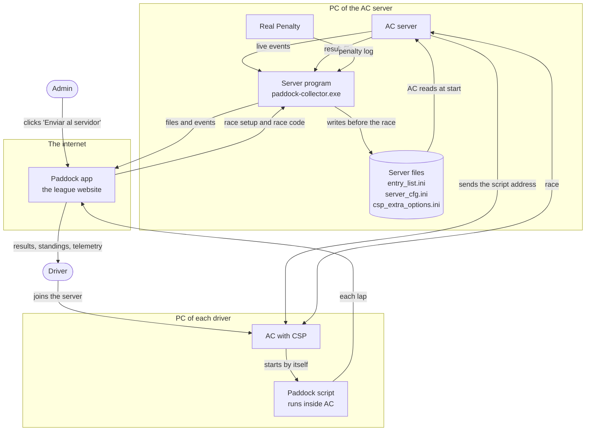
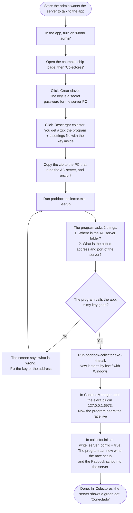
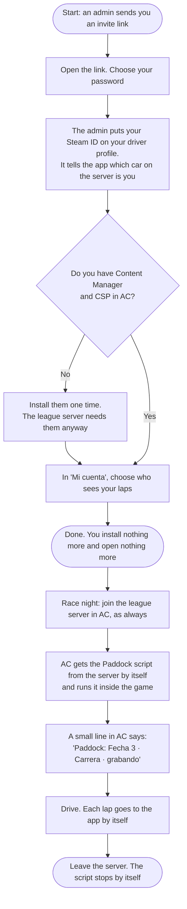
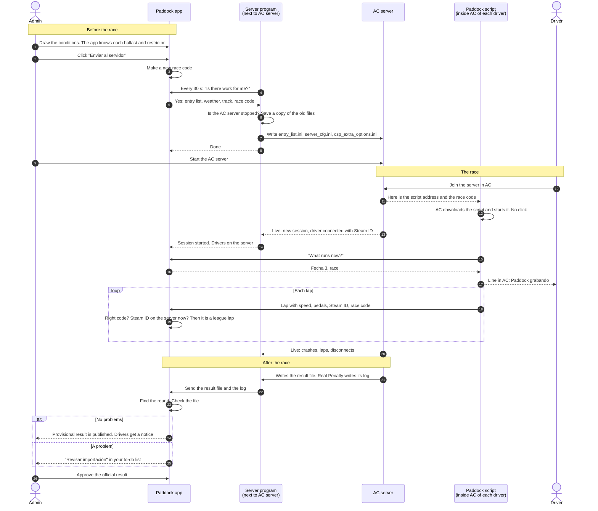
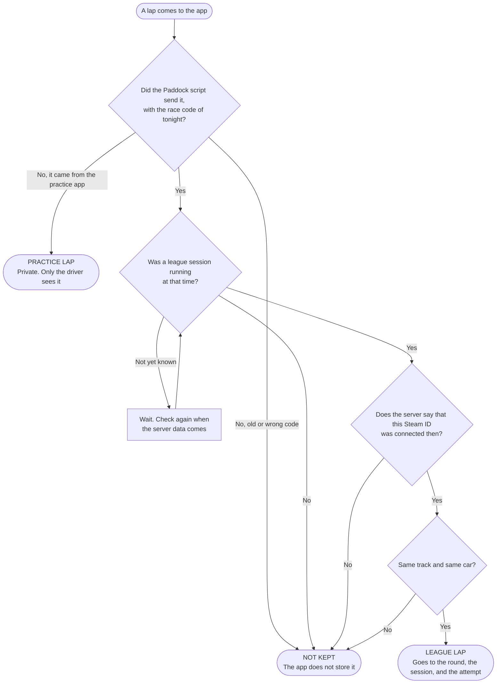

# How the AC integration works

Date: October 14, 2026

These diagrams show the plan in `docs/plans/ac-integration.md` when all phases are done. Phase 0 confirmed that the Paddock script idea works.

| Word | Meaning |
| --- | --- |
| Paddock app | The website of the league. It keeps results, standings, and laps. |
| Server program | paddock-collector.exe. It runs on the PC of the AC server. It sends files and events to the app, and writes the race setup into the server. |
| Paddock script | A small Lua script. The league server sends it into AC when a driver joins. It runs inside the game and sends each lap to the app. |
| Key | A secret password for the server program. The app shows it one time only. |
| Race code | A new secret for each race. The app makes it, the server gives it to the drivers on the server, and the script sends it with each lap. |
| CSP | Custom Shaders Patch. A free add-on for AC. The league server already needs it. |

## 0. The whole system in one picture

The boxes are the places where things run. The arrows show what goes where. Only the admin clicks one button. All other arrows happen by themselves.

## 1. Admin: connect the AC server to the app

The admin does this one time. After this, the server program starts by itself with Windows.

## 2. Driver: what you do

The driver installs nothing new and opens nothing. Nobody must remember to start a program.

## 3. Race night: who talks to whom

This happens on each race night. Read it from top to bottom. The arrows show who sends what to whom.

## 4. Is this lap a league lap?

The app asks these questions for each lap. Only a lap with 'yes' to all questions counts for the league.

## How the app trusts a lap

1. The lap has the race code of tonight. Only drivers on the league server get this code.
2. The server program says that this Steam ID was on the server at that time.
3. The lap time is inside a league session, and the track and the car are the same.
4. If one point fails, the app does not keep the lap.

## The work plan

| Phase | Days | What it gives |
| --- | --- | --- |
| 0. Test the script idea | 0.5 | Check that the server script runs by itself, can send to the app, and can read the Steam ID. |
| 1. Publish clean imports | 1 | A result file with no problems becomes a provisional result with no admin click. |
| 2. Session sync and the script | 2.5 | The app stores each server session and who was on it. The Paddock script sends the laps. |
| 3. Conditions and disconnects | 1 | The app reads the weather from the server. A disconnect gives a DNF suggestion. |
| 4. Send the setup to the server | 2 | 'Enviar al servidor' writes the entry list, ballast, restrictor, weather, and the race code. |
| 5. Install with one click | 1 | The server program becomes an .exe that starts with Windows and updates itself. |
| 6. Health and alerts | 0.5 | The app warns the admins when a collector stops or a race night has no results. |
